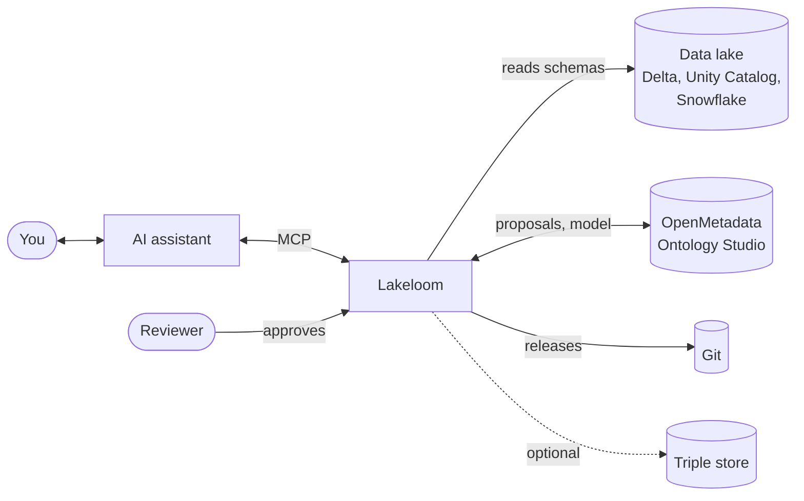

# Lakeloom

**Turn the tables of your data lake into a shared, governed business vocabulary, by talking
to an AI assistant.**

> **Status: alpha.** Usable for evaluation and pilots, not yet for production. APIs and tool
> names may still change. See [Status and limits](#status-and-limits).

## Why Lakeloom

In a data lake, the same idea hides behind many names: `cust_id`, `customer_no`,
`client_ref`. People guess what the columns mean, and so do AI agents, only faster. An
**ontology** is the agreed answer:
- the business terms, and what each one means;
- how they relate to each other;
- which data carries them.

Building one usually needs specialists and a long project. Lakeloom makes it incremental
and conversational:

- **You talk, the assistant works.** Lakeloom is an [MCP](https://modelcontextprotocol.io/)
  server. Any MCP client (Claude, Copilot, your own agent) reads the lake, proposes terms
  and explains them in plain language.
- **Humans decide.** Every change is a proposal that a reviewer approves with their own
  sign-in. An agent can never approve.
- **Value at every step.** A glossary, a data dictionary, a taxonomy and a search synonym
  file come out long before there is a full ontology.
- **Standard and open.** The model lives in
  [OpenMetadata](https://open-metadata.org/) and is exported as SKOS, OWL, SHACL and
  JSON-LD. Releases are versioned in Git.

## How it works



1. The assistant asks Lakeloom what to do next (`get_next_steps`), scans the lake, and
   drafts changes: new terms, definitions, a hierarchy, related terms.
2. You read the draft and its warnings, then submit it.
3. A reviewer approves it, and the change is applied in OpenMetadata as the reviewer.
4. A release tags the model in Git and can publish it to a triple store.

Nothing changes until a human approves it.

## The pipeline, and what each step gives you

Lakeloom follows the staged method of Jessica Talisman's *Ontology Pipeline* (see
[Credits](#credits-and-license)). Each stage rests on the one before, and each one already
produces something useful:

| Stage | What you build | What you can hand out right away |
|-------|----------------|----------------------------------|
| 1. Controlled vocabulary | Agreed terms with definitions and synonyms | **Business glossary** (Markdown/CSV) with a quality score |
| 2. Metadata profile (MAP) | Which tables and columns carry each term | **Data dictionary** of the scanned tables |
| 3. Taxonomy | Terms arranged from broad to narrow | **Taxonomy tree** (outline, Mermaid diagram, CSV) |
| 4. Thesaurus | Related terms, scope and history notes, deprecations | **Search synonym file** for Elasticsearch, OpenSearch or Solr; **query expansion** for search and RAG |
| 5. Ontology | Typed attributes and relations, rules | SHACL shapes, JSON-LD context, RDF and SKOS exports |
| 6. Knowledge graph | Versioned, linked, queryable model | Git releases, triple-store graphs, SPARQL, links to Wikidata and schema.org |

Ask the assistant *"what can I already hand out?"*. It lists every deliverable as ready,
partial or unavailable.

## Try it

You need a Docker-compatible engine with 8 GB of memory: Docker, OrbStack, Podman or
Rancher Desktop. The development stack runs OpenMetadata, Keycloak, Gitea, PostgreSQL, a
small fixture lake and Lakeloom on your machine.

```bash
git clone https://github.com/elcioabrahao/lakeloom
cd lakeloom
docker compose -f deploy/compose/docker-compose.yml up -d --wait   # the first start takes minutes
curl localhost:8000/readyz                                         # 200 when ready
```

Get a development token and connect an assistant. The example uses Claude Code; any MCP
client that speaks Streamable HTTP works the same way:

```bash
TOKEN=$(curl -s http://localhost:8180/realms/lakeloom/protocol/openid-connect/token \
  -d grant_type=client_credentials -d client_id=lakeloom-agent \
  -d client_secret=dev-agent-secret | python3 -c 'import sys, json; print(json.load(sys.stdin)["access_token"])')
claude mcp add --transport http lakeloom http://localhost:8000/mcp --header "Authorization: Bearer $TOKEN"
```

Then ask, in plain language:

- *"What does Lakeloom know? Call get_server_info."*
- *"Use the build_ontology prompt for the retail model."*
- *"Which terms do we already use? Harvest vocabulary candidates."*
- *"Export the glossary of retail as CSV."*

> The dev stack's credentials (such as `dev-agent-secret`) are public defaults. Never use
> them outside your machine. Tokens are short-lived: fetch a new one when it expires.

Ports, development users and local stdio use are described in the
[technical reference](docs/technical-reference.md#development-stack-and-clients).

## Documentation

| If you want to… | Read |
|-----------------|------|
| Understand the method in plain language | [The ontology pipeline](docs/guide/concepts/ontology-pipeline.md) |
| Build a first model, step by step | [Tutorial: your first model](docs/guide/tutorials/first-model.md) |
| See what each stage delivers | [What you get at each stage](docs/guide/concepts/deliverables.md) |
| Review proposals and publish releases | [Reviewing and releasing](docs/guide/reviewers/review-and-release.md) |
| Install, configure and run Lakeloom | [Operator guide](docs/guide/operators/README.md) |
| Build an agent: tools, prompts, resources, errors | [MCP reference](docs/guide/reference/README.md) |
| Look up a setting, a limit or an edge case | [Technical reference](docs/technical-reference.md) |
| Know why it is built this way | [Architecture decisions](docs/decisions/) |

The whole guide starts at [docs/guide](docs/guide/README.md).

## Design principles

- **OpenMetadata is the engine.** Lakeloom stores no second copy of the model. Terms,
  relations and change sets live in OpenMetadata. Governance notes that OpenMetadata cannot
  hold (scope notes, history notes, deprecations) are kept in Lakeloom's proposal log, and
  every read shows them.
- **Only humans approve.** Reviews require the reviewer's own identity, and OpenMetadata
  records it. Agents can draft, submit and release, never approve.
- **Every change is traceable.** Proposals record their evidence, rules and author, and
  every write is audited. Applied changes and releases become Git commits and tags.
- **Untrusted text stays inert.** Lake comments and catalog descriptions are always
  returned as quoted data, so they cannot instruct an agent.
- **No UI of its own.** Lakeloom offers an MCP server for agents, a read-only HTTP API for
  software and a CLI for operators. OpenMetadata provides the screens.

## Status and limits

Lakeloom is **alpha**:

- **Developed and tested against OpenMetadata 2.1.0-rc1.**
- **Tested only against fakes:** the Snowflake connector, the Databricks and Snowflake
  MCP-source examples and the triple-store sink.
- **Not modelled yet:** the canonical layer and crosswalks of the book's MAP, and an OWL
  reasoner.
- **Pre-1.0:** tool names and APIs may change between releases. See the
  [CHANGELOG](CHANGELOG.md).

## Contributing

Contributions are welcome. See [CONTRIBUTING.md](CONTRIBUTING.md) for the development setup,
tests and the DCO sign-off, and read the [Code of Conduct](CODE_OF_CONDUCT.md),
[Security policy](SECURITY.md) and [Governance](GOVERNANCE.md).

## Credits and license

Lakeloom is licensed under the [Apache License 2.0](LICENSE); see also [NOTICE](NOTICE).

The staged method follows Jessica Talisman, *Ontology Pipeline: A Framework for Building
Knowledge Infrastructures* (Technics Publications, 2026). *The Ontology Pipeline®* is her
registered trademark. [THIRD_PARTY.md](THIRD_PARTY.md) credits the standards and every tool
Lakeloom uses or ships, with their authors and licenses.

Lakeloom is an **independent project**. It is not affiliated with, endorsed by, or sponsored
by OpenMetadata, Collate, Databricks, Snowflake, Jessica Talisman or Technics Publications.
All trademarks belong to their respective owners.
